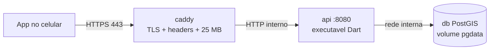

# Implantacao do backend

Passo a passo para colocar a API (Dart/shelf) + PostGIS + HTTPS em uma VPS com Docker.
Nada aqui escolhe provedor: o host e o servico de e-mail ficam para o Gava decidir
(ver "Pendente" no fim).

Arquivos envolvidos (todos em `backend/`):

| Arquivo | Papel |
| --- | --- |
| `Dockerfile` | Compila `bin/server.dart` em executavel nativo (imagem `dart:3.13.7`) e gera uma imagem final `scratch` de ~29 MB, usuario nao-root 65532, porta interna 8080, HEALTHCHECK em `/health`. |
| `deploy/healthcheck.dart` | Programa minimo usado pelo HEALTHCHECK (a imagem scratch nao tem curl/wget). |
| `docker-compose.yml` | `db` (PostGIS, sempre), `api` (profile `app`), `caddy` (profile `https`). Sem profile sobe so o banco, como no desenvolvimento local. |
| `deploy/docker-compose.prod.yml` | Override que tira do host as portas do banco e da API. |
| `deploy/Caddyfile` | Proxy reverso HTTPS (Let's Encrypt automatico), headers de seguranca, limite de 25 MB no corpo. |
| `.env.example` | Modelo de todas as variaveis. |
| `docs/openapi.yaml` | Descricao OpenAPI 3.1 da API (espelha `docs/CONTRATO.md`). |



Na producao so as portas 80 e 443 do Caddy ficam abertas para a internet. Banco e API
conversam pela rede interna do compose.

## 1. Pre-requisitos

- VPS Linux (ex.: Ubuntu 24.04 LTS, x86_64), 1 vCPU e 1-2 GB de RAM bastam para comecar.
  A imagem da API e compilada para a arquitetura da maquina que roda o build; em VPS ARM o
  build tambem funciona (a imagem `dart` e multi-arquitetura), so leva mais tempo.
- Docker Engine com o plugin Compose **>= 2.24** (o override usa a tag `!reset`).
  Instalar seguindo a documentacao oficial do Docker para a distribuicao.
- Um dominio (ou subdominio, ex.: `api.seudominio.com`) com registro **A** (e **AAAA**, se a
  VPS tiver IPv6) apontando para o IP da VPS. Confirme antes de subir o Caddy:
  `dig +short api.seudominio.com` precisa devolver o IP da VPS.
- Firewall liberando 22/tcp (SSH), 80/tcp (desafio ACME e redirecionamento), 443/tcp e
  443/udp (HTTP/3).

Atencao: portas publicadas pelo Docker passam por cima do `ufw`. Por isso a regra e nao
publicar banco nem API no host em producao (passo 3), em vez de confiar no firewall.

## 2. Codigo e .env

```sh
git clone <repositorio> rastro && cd rastro/backend
cp .env.example .env
chmod 600 .env
```

Edite o `.env`:

- `DB_PASSWORD`: senha longa e aleatoria (`openssl rand -base64 32`). Vale so na primeira
  subida do volume; para trocar depois, `ALTER USER postgres PASSWORD '...'` no banco e
  atualizar o `.env`.
- `DOMAIN` e `ACME_EMAIL`: dominio do passo 1 e um email seu (avisos do Let's Encrypt).
  Sem `ACME_EMAIL` o Caddy recusa a configuracao de proposito.
- `MAILER`: `console` enquanto nao houver provedor SMTP (o codigo de recuperacao de senha
  aparece so no log do servidor). Com provedor: `MAILER=smtp` e as variaveis `SMTP_*`.
- `DB_PUBLISH` e `API_PUBLISH` so importam se voce NAO usar o override do passo 3; nesse
  caso use `127.0.0.1:5433` e `127.0.0.1:8081`.

O `pubspec.lock` precisa estar presente: o build roda `dart pub get --enforce-lockfile`.
Hoje ele esta no `.gitignore` do backend, entao um clone limpo nao o traz (ver "Pendente").

## 3. Subir

Forma recomendada (banco e API sem porta no host):

```sh
docker compose -f docker-compose.yml -f deploy/docker-compose.prod.yml \
  --profile app --profile https up -d --build
```

Forma curta (sem o override; exige `DB_PUBLISH=127.0.0.1:5433` e
`API_PUBLISH=127.0.0.1:8081` no `.env`, para que so a propria VPS enxergue essas portas):

```sh
docker compose --profile app --profile https up -d --build
```

Ordem de subida: `db` fica healthy (`pg_isready`), depois `api` (HEALTHCHECK em `/health`),
depois `caddy`. Na primeira subida o Caddy pede o certificado ao Let's Encrypt; leva alguns
segundos.

Para nao repetir os `-f` em todo comando, da para fixar no `.env`:

```sh
COMPOSE_FILE=docker-compose.yml:deploy/docker-compose.prod.yml
COMPOSE_PROFILES=app,https
```

Com isso, `docker compose up -d --build`, `logs`, `ps` etc. ja usam o override e os
profiles. (Os exemplos abaixo assumem isso; sem essas linhas, acrescente os `-f` e
`--profile` do comando acima.)

Conferir:

```sh
docker compose ps                          # db, api e caddy "healthy"/"running"
curl -s https://api.seudominio.com/health  # {"status":"ok",...}
curl -sI http://api.seudominio.com/health  # 308 para https
```

No app: `--dart-define=SYNC_BASE_URL=https://api.seudominio.com`.

## 4. Logs

```sh
docker compose logs -f api      # metodo, caminho, status e tempo de cada requisicao
docker compose logs -f caddy    # acesso HTTPS e emissao/renovacao de certificado
docker compose logs --since 1h db
```

A API nunca registra corpo nem headers (senha e token ficam fora do log). Com
`MAILER=console`, o codigo de recuperacao de senha aparece no log da `api`: trate o log
como sensivel enquanto for assim.

O driver padrao do Docker (`json-file`) nao limita o tamanho dos logs. Na VPS, configure
rotacao em `/etc/docker/daemon.json` e reinicie o Docker:

```json
{ "log-driver": "json-file", "log-opts": { "max-size": "10m", "max-file": "5" } }
```

## 5. Backup do Postgres

Os arquivos FIT ficam dentro do banco (coluna `fit`), entao o dump contem tudo. Formato
custom (`-Fc`), comprimido:

```sh
mkdir -p ~/backups
docker compose exec -T db pg_dump -U postgres -Fc atividades \
  > ~/backups/atividades-$(date +%F-%H%M).dump
```

Agendar (cron do usuario, todo dia as 03:30, guardando 14 dias):

```cron
30 3 * * * cd /caminho/rastro/backend && docker compose exec -T db pg_dump -U postgres -Fc atividades > $HOME/backups/atividades-$(date +\%F).dump && find $HOME/backups -name 'atividades-*.dump' -mtime +14 -delete
```

Copie os dumps para fora da VPS (outro servidor, armazenamento de objetos, maquina local):
backup que mora so na VPS some junto com ela.

Restaurar (em banco vazio, ex.: VPS nova depois do passo 3):

```sh
docker compose exec -T db pg_restore -U postgres -d atividades --clean --if-exists \
  < ~/backups/atividades-AAAA-MM-DD.dump
docker compose restart api
```

Teste a restauracao de vez em quando; backup nunca restaurado nao e backup.

O volume `caddy_data` guarda os certificados. Perde-lo nao perde dados, so obriga a emitir
de novo (cuidado com o limite de emissoes do Let's Encrypt se isso acontecer muitas vezes).

## 6. Atualizar

```sh
cd /caminho/rastro/backend
git pull
docker compose exec -T db pg_dump -U postgres -Fc atividades > ~/backups/pre-update-$(date +%F-%H%M).dump
docker compose up -d --build      # recompila a API e recria so o que mudou
docker image prune -f             # remove imagens antigas sem uso
```

O esquema do banco evolui sozinho: o servidor aplica as mudancas de forma idempotente ao
conectar (`db/init.sql` so roda na criacao do volume). Durante o `up -d --build` a API fica
fora do ar por alguns segundos (instancia unica).

Voltar versao: `git checkout <commit anterior>` e `docker compose up -d --build`. Se a versao
nova ja tiver migrado o esquema, restaure o dump `pre-update` antes.

Atualizar Postgres/PostGIS de versao maior (ex.: 16 para 17) NAO e trocar a tag da imagem:
exige dump, volume novo e restore.

## 7. Operacao do dia a dia

- Parar tudo sem perder dados: `docker compose down` (sem `-v`!). `down -v` APAGA o banco.
- Reiniciar so a API: `docker compose restart api`. Reiniciar zera os contadores de limite
  de tentativas (eles vivem em memoria).
- Acessar o banco: `docker compose exec db psql -U postgres -d atividades`.
- O HEALTHCHECK da API chama `/health`, que responde 503 se o banco cair; nesse caso o
  container fica `unhealthy` (o Docker nao o reinicia sozinho por isso; `restart:
  unless-stopped` so cobre o processo morrendo).

## 8. Verificado localmente

Feito em Docker Desktop (Windows) com outro nome de projeto e portas, sem tocar no banco de
desenvolvimento:

- `docker build`: imagem final **28,7 MB**, usuario `65532:65532`.
- `docker compose -p rastro-infra-test --profile app up -d` com `DB_PUBLISH=5434` e
  `API_PUBLISH=8090`: db e api `healthy`; `GET /health` 200, `POST /auth/register` 201,
  `POST /auth/login` 200, `GET /me` 200 com token e 401 sem, `GET /activities?limit=5` 200,
  `POST /auth/password/forgot` 202 (codigo no log com `MAILER=console`), 6a falha de login
  seguida 429 com `Retry-After`.
- Caddy (`caddy:2.10-alpine`) na mesma rede com `DOMAIN=localhost` (certificado interno, sem
  Let's Encrypt): `caddy validate` ok, HTTPS 200 com HSTS e demais headers, HTTP 308 para
  HTTPS, upload de 27 MB recusado com 413.
- `docker compose config` sem profile gera exatamente a mesma configuracao do banco que o
  compose anterior (desenvolvimento local inalterado).

## Pendente (decisao do Gava)

1. **Host da VPS** (provedor, regiao, tamanho) e o **dominio**.
2. **Provedor de e-mail SMTP** para a recuperacao de senha, com SPF/DKIM configurados no
   dominio do remetente (`SMTP_FROM`). Ate la, `MAILER=console`.
3. Resolvido: o `backend/pubspec.lock` agora e versionado (aplicacao, nao biblioteca), entao o
   `--enforce-lockfile` do build funciona num clone limpo.
4. Resolvido: **IP real atras do proxy** via `TRUST_PROXY=1` no `.env` (padrao 0). Atras do Caddy,
   que sobrescreve o `X-Forwarded-For` com o IP da conexao, os limites por IP passam a contar
   por cliente. Nunca ligue sem o proxy na frente (o cliente escolheria o proprio IP).
5. Backup fora da VPS (destino dos dumps) e monitoramento externo de `/health`.
