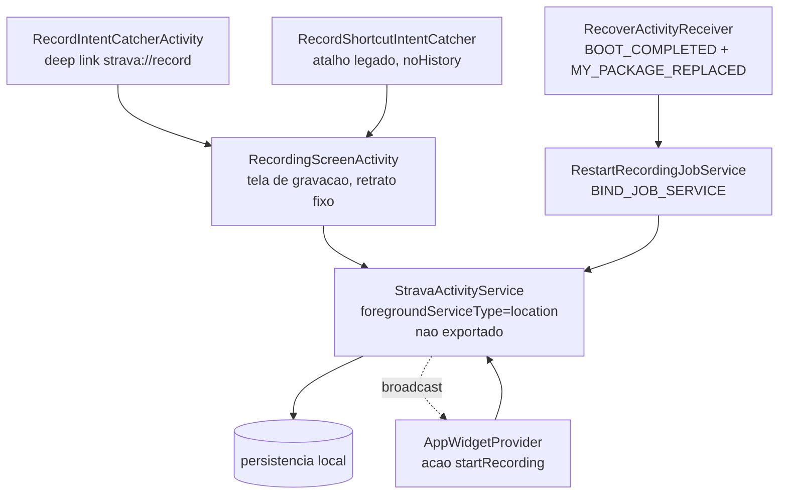

# 01 - Manifesto

## Resumo

O manifesto do Strava 486.9 declara um aplicativo monoproceso e muito grande: 402 activities,
16 activity-alias, 24 services, 30 receivers e 16 content providers. A gravacao de atividade e
sustentada por um unico foreground service do tipo `location`, com um receiver de BOOT_COMPLETED e
um JobService dedicados a retomar gravacoes interrompidas. As permissoes sao pedidas em blocos que
revelam as funcionalidades: localizacao fina, reconhecimento de atividade fisica, Bluetooth para
sensores, Health Connect para exportar treinos, midia/camera para fotos e um conjunto de permissoes
de notificacao e publicidade. A superficie exportada e ampla (106 activities exportadas), quase toda
por causa de deep links `strava://` e links de `strava.com`.

## Como o Strava resolve

### Identidade do pacote e configuracao global

O pacote e `com.strava`, `versionCode` 12400193, `versionName` 486.9, `minSdkVersion` 32,
`targetSdkVersion` 36, compilado contra o SDK 37. O APK e um App Bundle: o manifesto declara
`requiredSplitTypes="base__abi,base__density"`, confirmando que `base.apk` depende dos splits de ABI
e densidade que extraimos.

A tag `<application>` traz escolhas que importam para um app de gravacao:

- `android:name` aponta para uma classe `Application` propria do app, que e o ponto de entrada da
  injecao de dependencias e da inicializacao dos SDKs.
- `largeHeap="true"`. Pedir heap grande e tipico de app que mantem mapas, imagens e buffers de
  stream de GPS em memoria ao mesmo tempo.
- `extractNativeLibs="false"`. As bibliotecas `.so` sao carregadas direto do APK, sem copia para o
  diretorio do app. Reduz espaco e tempo de instalacao.
- `allowBackup="true"` com um `fullBackupContent` apontando para um esquema XML proprio, ou seja, o
  backup e seletivo e nao pega tudo.
- `networkSecurityConfig` aponta para um XML proprio de configuracao de rede.
- `resizeableActivity="false"` e `supportsRtl="false"`. O app assume tela de celular em retrato.
- `localeConfig` declarado, o que habilita a selecao de idioma por app do Android 13+.
- `profileable android:shell="true"`, permitindo profiling do build de producao via shell.

Nao existe **nenhuma** declaracao `android:process` no manifesto. Todo o app, inclusive o servico de
gravacao, roda no mesmo processo. Isso e uma decisao de arquitetura relevante: nao ha isolamento de
memoria entre a UI e a gravacao, e um crash na UI derruba a gravacao junto. Por isso a existencia dos
mecanismos de recuperacao descritos abaixo.

### Permissoes, agrupadas pela funcionalidade que revelam

| Grupo | Permissoes declaradas | O que indica |
| --- | --- | --- |
| Localizacao | `ACCESS_FINE_LOCATION`, `ACCESS_COARSE_LOCATION`, mais as duas repetidas como `uses-permission-sdk-23` | GPS de alta precisao e o nucleo do app. Nao ha `ACCESS_BACKGROUND_LOCATION`: a gravacao depende de foreground service, nao de localizacao em background. |
| Foreground service | `FOREGROUND_SERVICE`, `FOREGROUND_SERVICE_LOCATION` | Gravacao com o app fora da tela, no modelo obrigatorio do Android 14+. |
| Energia e ciclo de vida | `WAKE_LOCK`, `RECEIVE_BOOT_COMPLETED`, `SCHEDULE_EXACT_ALARM` | Manter a CPU acordada durante a gravacao, retomar depois de reinicio e agendar alarmes exatos. |
| Movimento | `ACTIVITY_RECOGNITION` | Deteccao de tipo de movimento, insumo plausivel para pausa automatica e para contagem passiva de passos. |
| Sensores externos | `BLUETOOTH_SCAN` (com `usesPermissionFlags="neverForLocation"`), `BLUETOOTH_CONNECT`, mais `BLUETOOTH` e `BLUETOOTH_ADMIN` limitados a `maxSdkVersion=30` | Cintas de frequencia cardiaca e medidores de potencia. O flag `neverForLocation` e uma declaracao explicita de que o scan BLE nao serve para inferir localizacao, o que evita exigir permissao de localizacao so pelo Bluetooth. |
| Saude | `health.WRITE_EXERCISE`, `health.WRITE_DISTANCE`, `health.WRITE_TOTAL_CALORIES_BURNED`, `health.READ_WEIGHT` | Integracao com Health Connect: escreve o treino, le o peso (necessario para estimar calorias). Pede so o minimo. |
| Midia | `CAMERA`, `READ_MEDIA_IMAGES`, `READ_MEDIA_VIDEO`, `READ_MEDIA_VISUAL_USER_SELECTED`, `ACCESS_MEDIA_LOCATION`, `READ_EXTERNAL_STORAGE`, `WRITE_EXTERNAL_STORAGE` (ate SDK 29), `RECORD_AUDIO` | Fotos e videos na atividade. `ACCESS_MEDIA_LOCATION` permite ler o EXIF de GPS das fotos para posiciona-las na rota. |
| Rede | `INTERNET`, `ACCESS_NETWORK_STATE`, `ACCESS_WIFI_STATE` | Sincronizacao e decisao de quando subir dados. |
| Notificacoes e push | `POST_NOTIFICATIONS`, `VIBRATE`, `C2D_MESSAGE` (propria, `signature`), `com.google.android.c2dm.permission.RECEIVE` | Notificacao do foreground service e push. |
| Conta e contatos | `GET_ACCOUNTS`, `USE_CREDENTIALS`, `READ_CONTACTS` | Login e sugestao de amigos. |
| Compras | `com.android.vending.BILLING` | Assinatura. |
| Publicidade e atribuicao | `AD_ID`, `ACCESS_ADSERVICES_ATTRIBUTION`, `ACCESS_ADSERVICES_AD_ID`, `BIND_GET_INSTALL_REFERRER_SERVICE` | Atribuicao de instalacao e analytics. Nada disso e necessario para gravar. |
| Outros | `DETECT_SCREEN_CAPTURE`, `READ_GSERVICES` | Deteccao de captura de tela e servicos do Google. |

O app declara tres permissoes proprias, todas com `protectionLevel="signature"`: uma para push
legado, uma chamada `SHARED_IDENTITY` que protege a leitura do provider de identidade compartilhada,
e uma de receiver nao exportado. `signature` significa que so outro app assinado com a mesma chave
pode usa-las, o padrao correto para comunicacao entre apps da mesma empresa.

`uses-feature`: camera e Wi-Fi marcados como `required="false"` (o app funciona sem), USB host
tambem opcional, e OpenGL ES 3.0 como `required="true"` -- esse e obrigatorio, imposto pelo SDK de
mapas.

`uses-library` opcionais: `android.ext.adservices`, `androidx.window.extensions` e
`androidx.window.sidecar` (suporte a dobraveis e multijanela).

### O eixo da gravacao

Quatro componentes formam o nucleo da gravacao, e a forma como estao declarados conta a historia:

Pontos a destacar:

1. **Um unico servico de localizacao.** `StravaActivityService` e o unico componente do app com
   `foregroundServiceType="location"`. Ele e declarado sem `android:exported`, portanto nao
   exportado, e sem permissao de bind: so o proprio app inicia. Toda a gravacao passa por ele.
   (O outro foreground service do manifesto e o `SystemForegroundService` do WorkManager, com tipo
   `shortService`, que nao tem relacao com GPS.)

2. **Recuperacao depois de morte do processo.** O par `RecoverActivityReceiver` +
   `RestartRecordingJobService` existe exatamente porque o app e monoproceso e pode ser morto. O
   receiver escuta `BOOT_COMPLETED` (o celular reiniciou no meio de um pedal) e
   `MY_PACKAGE_REPLACED` (o app foi atualizado durante a gravacao). O JobService e o caminho para
   religar o servico respeitando as restricoes de inicio em background do Android moderno -- um
   receiver nao pode iniciar um foreground service de localizacao direto, mas um job agendado pode.
   Isso implica que o estado da gravacao e persistido de forma incremental em disco, nao so em
   memoria; o detalhe fica para a etapa 05.

3. **Comunicacao por broadcast.** O widget da tela inicial escuta duas acoes proprias,
   `recordingStatsChangeAction` e `recordingStateChangeAction`. O servico de gravacao publica
   mudancas de metrica e de estado (gravando, pausado, parado) por broadcast, e tanto o widget
   quanto outras partes do app consomem. E um barramento de eventos simples e desacoplado, usando o
   mecanismo do proprio sistema.

4. **Multiplos pontos de entrada para comecar a gravar.** Tela principal, deep link
   `strava://record`, atalho da tela inicial (shortcuts estaticos declarados na SplashActivity) e
   botao no widget. Todos convergem para o mesmo servico.

Ha tambem um `LiveTrackingSettingsUpdateService` (nao exportado, sem tipo de foreground), ligado ao
compartilhamento de localizacao ao vivo (Beacon), e activities de configuracao de gravacao e de
sensores alcancaveis por deep link (`strava://record/settings/sensors`).

### Superficie exportada

Do total: 106 activities, 8 services, 6 receivers e 1 provider exportados.

A massa de activities exportadas nao e descuido, e consequencia do modelo de deep link. O app
registra 115 intent-filters com scheme `strava`, 49 com `http` e 46 com `https`, nos hosts
`strava.com`, `www.strava.com` e `app.strava.com`, mais cerca de 100 hosts internos do scheme
proprio (`settings`, `routing`, `challenges`, `record`, `routes`, `training`, e assim por diante).
O padrao usado e quase sempre o mesmo: uma activity `...IntentCatcherActivity` com
`noHistory="true"` e tema de splash, que resolve o link, decide para onde ir e sai da pilha. Isso
mantem o roteamento de deep link separado das telas de verdade -- e um padrao que vale copiar.

Dos services exportados, quase todos sao de bibliotecas de terceiros e protegidos por permissao do
sistema (`BIND_JOB_SERVICE`, `BIND_REMOTEVIEWS`). Os proprios do Strava expostos sao o listener de
mensagens do Wear OS e dois job services (onboarding e tracking de notificacao). O servico de
gravacao nao esta na lista.

O unico provider exportado do Strava expoe a autoridade `com.strava.identity` e exige na leitura a
permissao propria `SHARED_IDENTITY`, de nivel `signature` -- identidade compartilhada entre apps da
mesma empresa, protegida corretamente. Os outros 15 providers sao `FileProvider` para
compartilhamento de arquivos e providers de inicializacao de SDKs, todos nao exportados.

### Modularizacao visivel pelos nomes dos pacotes

Os prefixos dos componentes mostram uma separacao por feature bem marcada. Os maiores blocos:
`settings` (46 componentes), `clubs` (24), `view` (20), `recordingui` (20), `gear` (11), `chats`
(10), `widget`, `challenges`, `activitydetail` (9 cada), `profile`, `competitions`, `authorization`
(8 cada), seguidos por dezenas de modulos menores (`segments`, `routing`, `photos`, `posts`,
`goals`, `activitysave`, `healthconnect`, `strengthtraining`, `bestefforts`, `aichat`,
`trainingzones`, `ageassurance`...).

Vale notar a separacao entre `com.strava.recording` (o motor: servico, receiver, job) e
`com.strava.recordingui` (as telas). Essa fronteira e justamente a que queremos no nosso app: a
gravacao nao deve depender da UI para existir.

Tambem aparecem modulos que denunciam build unico para dev e producao: `superuser`,
`subscriptionssuperuser` e `nettools` (ferramentas internas de rede), com activities proprias,
presumivelmente escondidas atras de uma flag em producao.

### Inicializacao

O app usa `androidx.startup.InitializationProvider` como ponto unico de inicializacao, com uma lista
de inicializadores declarados por meta-data: mapas (dois do Mapbox), chat (dois do Stream),
`ProcessLifecycleInitializer`, permissoes de push, OkHttp, Joda-Time, Rive (animacoes) e
`ProfileInstaller` (Baseline Profiles, para melhorar o tempo de abertura). Em vez de encher a classe
`Application`, cada SDK se registra por conta propria num unico provider. O detalhamento das
bibliotecas fica para a etapa 02.

O manifesto tambem carrega meta-data de configuracao de servicos externos, incluindo chaves de API.
Registro apenas que existem: ha uma chave de API de mapas do Google, um identificador e um token de
cliente do SDK do Facebook, e um DSN de monitoramento de erros. Os valores nao foram copiados para
este relatorio nem para qualquer outro arquivo do repositorio.

### Integracao com Health Connect

Alem das quatro permissoes `android.permission.health.*`, ha uma activity que responde a
`androidx.health.ACTION_SHOW_PERMISSIONS_RATIONALE` (a tela que explica ao usuario por que o app
quer os dados) e um `activity-alias` que responde a `android.intent.action.VIEW_PERMISSION_USAGE`
protegido por `START_VIEW_PERMISSION_USAGE`. Esse e o contrato completo exigido pelo Health Connect
no Android 14+; nao e opcional se o app quiser gravar exercicios no repositorio de saude.

## Bibliotecas envolvidas

Visiveis apenas pelo manifesto nesta etapa (detalhamento na etapa 02):

| Biblioteca | Finalidade | Licenca |
| --- | --- | --- |
| AndroidX (work, room, startup, glance, health, profileinstaller, window, core) | WorkManager, banco local, inicializacao, widgets, Health Connect, baseline profiles | Apache-2.0 |
| Mapbox Maps / Common | mapas e um receiver proprio de atualizacoes de localizacao | proprietaria (SDK comercial) |
| Firebase (messaging, analytics, installations, datatransport) | push e analytics | Apache-2.0 (SDK), servico proprietario |
| Google Play Services (auth, measurement, billing, fitness, ads) | login, compras, publicidade | proprietaria |
| ML Kit (vision text) | OCR, provavelmente leitura de dados de tela de equipamento | proprietaria |
| Stream Chat (`io.getstream`) | chat/mensagens | proprietaria com tier gratuito |
| Sentry | monitoramento de erros e performance | MIT |
| Braze | engajamento e push marketing | proprietaria |
| Iterable | marketing por email/push | proprietaria |
| Zendesk (support, guide) | central de ajuda | proprietaria |
| Facebook SDK | login social e compartilhamento | licenca propria do Facebook |
| OkHttp | cliente HTTP | Apache-2.0 |
| Picasso | carregamento de imagens | Apache-2.0 |
| Joda-Time (`net.danlew.android.joda`) | datas e horas | Apache-2.0 |
| Rive | animacoes vetoriais | MIT (runtime) |

## Decisao para o nosso app

**Igual:**

- Um unico foreground service de localizacao, nao exportado, como dono da gravacao.
- Separacao de pacote entre o motor de gravacao e a UI de gravacao. A gravacao nao conhece a tela.
- Receiver de `BOOT_COMPLETED` e `MY_PACKAGE_REPLACED` mais um job para retomar gravacao
  interrompida. Isso obriga a persistir o estado incrementalmente, o que e a decisao certa de
  qualquer jeito.
- Nao pedir `ACCESS_BACKGROUND_LOCATION`. Foreground service com notificacao visivel resolve e e
  muito mais facil de aprovar na Play Store.
- `BLUETOOTH_SCAN` com `neverForLocation` quando chegarmos a sensores.
- Padrao de activity catcher com `noHistory` para deep links, separada das telas reais.
- Inicializacao via `androidx.startup` em vez de uma classe `Application` inflada.
- Contrato completo do Health Connect (rationale + `VIEW_PERMISSION_USAGE`) se quisermos escrever
  treinos no repositorio de saude.
- Shortcuts estaticos e um ponto de entrada por deep link para "comecar a gravar".

**Diferente:**

- Comecar com o conjunto minimo de permissoes: `ACCESS_FINE_LOCATION`, `ACCESS_COARSE_LOCATION`,
  `FOREGROUND_SERVICE`, `FOREGROUND_SERVICE_LOCATION`, `WAKE_LOCK`, `RECEIVE_BOOT_COMPLETED`,
  `POST_NOTIFICATIONS`, `INTERNET`, `ACCESS_NETWORK_STATE`. Nada de publicidade, atribuicao,
  contatos ou `DETECT_SCREEN_CAPTURE`. `ACTIVITY_RECOGNITION` entra so quando a pausa automatica
  precisar dela de fato.
- Nao usar `largeHeap`. Se precisarmos, e sinal de que estamos segurando dados demais em memoria.
- Avaliar rodar o servico de gravacao em um processo separado (`android:process`). O Strava nao faz,
  e aceita o risco de a UI derrubar a gravacao. Com processo separado, um crash na UI nao perde o
  treino. O custo e comunicacao entre processos e mais complexidade; decidir depois da etapa 05,
  quando soubermos como a persistencia se comporta.
- Em vez de broadcast do sistema para publicar metricas, usar um fluxo observavel em memoria (Flow
  ou stream, conforme a stack escolhida). Broadcast fica so para o widget, que e um processo externo.
- Superficie exportada minima. Um ou dois catchers de deep link, nao cem.
- Nenhum SDK de analytics, marketing ou publicidade na primeira versao.

## Duvidas em aberto

- Qual componente decide quando parar a gravacao por inatividade, e como a pausa automatica se
  relaciona com `ACTIVITY_RECOGNITION`. O manifesto nao responde; vai para a etapa 03.
- O que exatamente o `RestartRecordingJobService` recupera: o ponto onde parou ou a atividade
  inteira. Depende do modelo de dados, etapa 05.
- Por que `RECORD_AUDIO` esta declarado. Pode ser gravacao de video com som, pode ser outra feature.
- `SCHEDULE_EXACT_ALARM` em um app de atividades: suspeita de lembretes de treino ou de watchdog da
  gravacao. Checar na etapa 03.
- Se a notificacao do foreground service usa um canal dedicado e qual o comportamento quando o
  usuario desativa notificacoes do app. Nao da para ver no manifesto.
- Para que serve o ML Kit de reconhecimento de texto. Hipotese: ler numeros de uma tela de
  esteira/bicicleta ergometrica a partir de uma foto.
