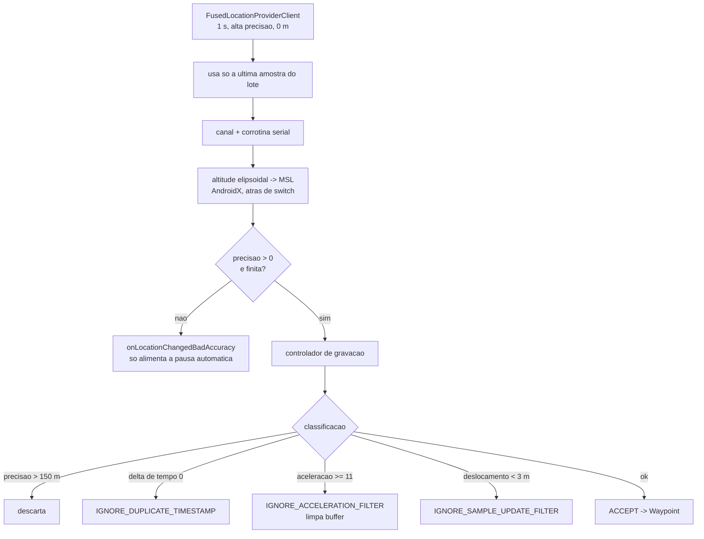

# 03 - Gravacao e GPS

## Resumo

A gravacao do Strava gira em torno de um unico foreground service (`StravaActivityService`) que
delega quase tudo a um controlador de gravacao (classe ofuscada, identificada pela tag de log
`RecordingController`). A fonte de localizacao e o `FusedLocationProviderClient` do Google Play
Services, pedido com prioridade de alta precisao e intervalo de 1 segundo. Cada amostra passa por
uma esteira de tres estagios -- correcao de altitude, portao de sanidade de precisao e classificacao
do ponto -- antes de virar um `Waypoint` com `isFiltered` e uma `WaypointClassification` que diz por
que foi aceito ou descartado. A pausa automatica tem duas implementacoes diferentes, escolhidas pelo
esporte: corrida usa o acelerometro, pedal usa a velocidade do GPS. Pausa, estado e pontos sao
gravados em disco de forma incremental, coerente com o fato de o app ser monoproceso (etapa 01) e
poder ser morto no meio de uma atividade.

## Como o Strava resolve

### O servico em primeiro plano

`StravaActivityService` e um `Service` comum (nao bound como principal; tem `onBind` para a UI se
conectar). O ciclo e simples e revela a arquitetura:

- `onCreate` constroi os ouvintes e registra `BroadcastReceiver`s para acoes proprias:
  `...StravaActivityService.PAUSE`, `.RESUME`, `.LAP`, `.OverwriteBeaconState`,
  `com.strava.discardActivityAction` e `com.strava.saveActivityWithEditAction`. Ou seja, o controle
  da gravacao (pausar, retomar, marcar volta, descartar, salvar) chega por broadcasts, o que permite
  que notificacao, widget e UI disparem as mesmas acoes.
- `onStartCommand` interpreta o `Intent` por dois extras: `start_mode`
  (`record`, `stop_record`, `toggle_record`, `recover_activity`) e `record_action` (`PAUSE`,
  `RESUME`). Ele sempre retorna `START_STICKY` (1): se o sistema matar o servico, o Android o recria
  com `Intent` nulo, e o codigo trata esse caso explicitamente (ver recuperacao abaixo).
- A promocao a primeiro plano fica num metodo `promoteToForeground`: ele pede ao controlador uma
  notificacao (via uma fabrica de notificacao) e chama `startForeground` com ela. E essa notificacao
  persistente, somada ao `foregroundServiceType=location` do manifesto, que mantem o GPS ligado com
  o app fora da tela no modelo obrigatorio do Android 14+.

Como todo o app roda num unico processo (nenhum `android:process` no manifesto), o servico nao esta
isolado da UI. A protecao contra perda de dados nao vem de isolamento, e sim de persistencia
incremental mais recuperacao.

### Como a localizacao e pedida

Uma fabrica recebe o controlador de gravacao como ouvinte e devolve o provedor de localizacao, que
embrulha o `FusedLocationProviderClient`. O `LocationRequest` montado ali tem parametros bem
definidos:

- prioridade de alta precisao (o valor 100 da constante `PRIORITY_HIGH_ACCURACY`);
- intervalo e intervalo minimo de atualizacao de **1 segundo** (escrito no codigo como uma duracao
  de 1 segundo convertida para milissegundos, nao como um literal `1000`);
- deslocamento minimo de **0 metro**: o Strava quer a amostra mesmo que o aparelho esteja parado --
  a decisao de descartar e dele, nao do provedor;
- `waitForAccurateLocation = true`: o GMS espera estabilizar a primeira correcao antes de entregar;
- sem limite de numero de atualizacoes nem de duracao.

O `LocationCallback` do GMS recebe lotes de localizacoes e aproveita **somente a ultima** de cada
lote, descartando as intermediarias. Isso e importante: quando o sistema agrupa amostras para
economizar bateria, o Strava nao recupera o historico do lote, ele fica com o estado mais recente.

### A esteira de processamento de cada amostra

O ponto nao vai direto do callback para o controlador. Ele e enfileirado num canal e consumido por
uma unica corrotina serial, o que garante ordem e evita concorrencia no estado do filtro. Nessa
esteira acontecem, em ordem:

1. **Correcao de altitude.** Se um feature switch estiver ligado, a localizacao tiver altitude e
   ainda nao carregar altitude MSL (verificada pela API da AndroidX a partir do Android 13, ou pela
   presenca de um extra conhecido em versoes anteriores), a altitude elipsoidal do GPS e convertida
   em altitude acima do nivel medio do mar num dispatcher proprio. Se a conversao falhar por erro de
   I/O, o erro e registrado e o ponto segue com a altitude crua. Isso fecha uma duvida da etapa 04:
   a elevacao usada nas metricas e altitude de GPS corrigida para o geoide, por banco local da
   AndroidX, e a correcao e opcional (atras de switch) e pode falhar sem derrubar a gravacao.
2. **Montagem do `RecordingLocation`.** O objeto carrega a `Location` original mais dois relogios
   capturados na hora: o tempo monotonico do aparelho e o tempo de parede. Daqui saem tambem
   `accuracy`, `verticalAccuracyMeters`, `speed`, `bearing` e os sinalizadores de validade de cada
   um (`isSpeedValid`, `isAccuracyValid`, etc.) -- o modelo distingue "o provedor nao informou" de
   "o provedor informou zero".
3. **Portao de sanidade de precisao.** A amostra so e entregue como boa se a precisao for
   estritamente positiva e menor que um teto absurdo (2^31). Caso contrario vai para um callback
   separado, `onLocationChangedBadAccuracy`. Vale sublinhar que **este portao nao e o filtro de
   qualidade**: ele so rejeita precisao desconhecida (zero) ou lixo. O corte real de qualidade esta
   no modelo do ponto, descrito abaixo.

Pontos com precisao ruim nao sao simplesmente jogados fora: eles ainda alimentam o detector de pausa
automatica, e se a gravacao estiver auto pausada eles zeram o buffer de pontos recentes. Ou seja, o
Strava usa sinal ruim para decidir sobre movimento, mas nao para medir trajeto.

### Filtragem de ruido e classificacao do ponto

O corte de qualidade vive numa funcao do proprio `RecordingLocation`, e e explicito:

```
deveFiltrarPorPrecisao(loc):
    retorna (loc.temPrecisao e loc.precisao > 150 m) ou loc.precisao <= 0
```

Entao o limiar de precisao horizontal e **150 metros** (e precisao nao informada tambem reprova).
Esse e um corte generoso de proposito: ele descarta o absurdo, nao a imprecisao comum de cidade.

O trabalho fino e feito depois, quando o controlador classifica cada amostra numa
`WaypointClassification`. Os valores observados contam a historia:

- `ACCEPT` -- o ponto entra em distancia, splits e polyline;
- `IGNORE_MANUAL_PAUSE` -- chegou durante pausa manual;
- `IGNORE_DUPLICATE_TIMESTAMP` -- delta de tempo zero em relacao ao ultimo ponto;
- `IGNORE_SAMPLE_UPDATE_FILTER` -- a amostra nao acrescenta informacao suficiente (deslocamento
  abaixo de cerca de 3 metros em relacao ao ultimo ponto aceito);
- `IGNORE_ACCELERATION_FILTER` -- o ponto implicaria uma aceleracao implausivel.

O filtro de aceleracao e o mais interessante, e responde a duvida da versao anterior deste
relatorio sobre "velocidade maxima plausivel": o Strava nao compara velocidade contra um teto fixo,
ele compara a **variacao** de velocidade entre tres pontos consecutivos. Em pseudocodigo nosso:

```
filtroAceleracao(novo, p1, p2):
    dt1 = tempo(novo) - tempo(p1)
    dt2 = tempo(p1)   - tempo(p2)
    se dt1 == 0 ou dt2 == 0: nao da para avaliar
    v1 = distancia(novo, p1) / dt1        # velocidade do trecho recente
    v2 = distancia(p1,  p2) / dt2         # velocidade do trecho anterior
    aceleracao = (v1 - v2) / dt1
    aceita = aceleracao < 11.0            # limiar observado
    se nao aceita:
        marca IGNORE_ACCELERATION_FILTER
        limpa o buffer de pontos recentes  # recomeca a referencia
```

O limiar de 11 (em unidades de m/s^2) e perto da aceleracao da gravidade: qualquer salto de posicao
que exigiria aceleracao maior que isso e tratado como erro de GPS. Quando isso acontece, o buffer de
pontos recentes e esvaziado, o que faz o filtro recomecar do zero em vez de arrastar uma referencia
corrompida -- o mesmo que acontece ao sair de um tunel.

O controlador mantem um buffer dos **5 pontos mais recentes** (lista encadeada com descarte do mais
antigo), usado tanto pelo filtro de aceleracao quanto pela deteccao de retomada em corrida.

Resumindo a divisao de trabalho:



### Pausa automatica: duas implementacoes, escolhidas pelo esporte

Esta e a descoberta mais substancial da etapa. A pausa automatica e uma interface pequena
(recebe ponto, recebe resumo, destroi) com **duas** implementacoes concretas, e a escolha acontece
num unico ponto:

```
montarDetector(tipoDeAtividade, prefs, sensores):
    destroi o detector anterior, se houver
    se tipoNormalizado == CORRIDA e prefs.autoPausaCorridaLigada:
        se existe acelerometro: detector = detectorPorAcelerometro
        senao se tipoNormalizado == PEDAL: detector = detectorPorVelocidade
    senao se tipoNormalizado == PEDAL e prefs.autoPausaPedalLigada:
        detector = detectorPorVelocidade
    senao:
        detector = nenhum
```

Consequencias praticas: caminhada, trilha e os outros esportes **nao tem pausa automatica** nenhuma;
corrida depende do acelerometro e, num aparelho sem ele, fica sem pausa automatica; pedal sempre usa
GPS. Se o usuario desliga a preferencia no meio da atividade, o detector e destruido e, se a
gravacao estava auto pausada naquele instante, o estado e convertido em pausa manual (para nao ficar
preso num estado que ninguem mais vai retomar).

**Detector por velocidade de GPS (pedal).** Um relogio de guarda, nao um acumulador:

```
aoReceberPonto(loc):
    se gravacao esta pausada ou auto pausada: so guarda o ponto e sai
    se loc.velocidadeValida:
        emMovimento = loc.velocidade > 0.33 m/s
    senao se ha ponto anterior com tempo diferente:
        emMovimento = distancia(loc, anterior) / dt > 0.33 m/s
    senao:
        emMovimento = indefinido (nao rearma)
    se emMovimento:
        cancela o alarme pendente
        agenda o alarme de auto pausa para 10 s a frente
    guarda loc como anterior
```

O desenho e elegante: cada amostra em movimento reempurra o alarme 10 segundos para a frente. Se o
ciclista para, nenhuma amostra em movimento chega, o alarme dispara e a atividade e auto pausada. Os
dois numeros que importam sao **0,33 m/s** (cerca de 1,2 km/h, o piso de "esta se movendo") e
**10 segundos** (quanto tempo parado antes de pausar). Note que esse detector nao faz auto resume
proprio: a retomada em pedal vem da logica do controlador sobre os pontos recentes.

**Detector por acelerometro (corrida).** Nao olha para o GPS de forma alguma (as duas funcoes que
recebem localizacao estao vazias). Ele reagenda a si mesmo a cada **50 ms** lendo o ultimo evento do
acelerometro, e trabalha com *jerk* (variacao da aceleracao), nao com aceleracao bruta -- assim a
gravidade, que e constante, sai da conta:

```
aCada50ms():
    dt = max(0,05 s, |agora - ultimaLeitura|)
    se dt > 0,2 s:
        descarta (a leitura esta velha demais) e so atualiza a referencia
        retorna
    jerk = norma( (aceleracaoAtual - aceleracaoAnterior) / dt )

    # duas medias exponenciais da mesma grandeza, com constantes de tempo diferentes
    pesoRapido = 2^(-dt/0,4)      # meia vida de 0,4 s: reage rapido
    rapida = pesoRapido*rapida + (1-pesoRapido)*jerk
    pesoLento  = 2^(-dt/10)       # meia vida de 10 s: representa o "normal" recente
    lenta  = pesoLento*lenta  + (1-pesoLento)*jerk
    lenta  = max(50, lenta)       # piso, para nao colapsar em silencio total

    # maquina de estados por razao entre as duas medias
    se estadoAtual == EM_MOVIMENTO e 3*rapida < lenta:
        guarda lenta como ultimoValorEmMovimento
        lenta = rapida
        estadoAtual = PARADO
    senao se estadoAtual == PARADO e rapida > 3*lenta:
        lenta = rapida
        estadoAtual = EM_MOVIMENTO
    senao se estadoAtual == PARADO e rapida > ultimoValorEmMovimento:
        estadoAtual = EM_MOVIMENTO

    se gravacao esta AUTO_PAUSADA e estadoAtual == EM_MOVIMENTO: pedir auto resume
    se gravacao esta GRAVANDO    e estadoAtual == PARADO:        pedir auto pausa
```

O ponto central e que nao existe limiar absoluto de movimento: a decisao e **relativa**, por um
fator de 3 entre a media rapida e a media lenta. Isso faz o detector se calibrar sozinho ao aparelho,
ao bolso e ao estilo de corrida de cada pessoa, em vez de depender de um numero fixo de aceleracao.
A assimetria tambem e proposital -- precisa de 3x para entrar em movimento e 1/3 para sair, o que
cria histerese e evita oscilar entre pausado e gravando.

Quando a auto pausa e efetivada, o fluxo e: pausa o cronometro da volta corrente, troca o estado para
auto pausado, registra o evento de pausa junto aos dados, avisa a atividade ativa e manda um evento
de analytics. Se por alguma corrida de eventos a auto pausa for pedida fora do estado "gravando", o
pedido e ignorado com um log.

### Tela desligada e bateria

- A permissao `WAKE_LOCK` (etapa 01) e usada para manter a CPU acordada durante a gravacao, mesmo
  com a tela apagada. Isso e necessario tambem porque o detector de corrida roda a 50 ms.
- Nao ha `ACCESS_BACKGROUND_LOCATION`: a gravacao nao roda "em background" no sentido do Android;
  ela roda sob um foreground service de localizacao, que e o caminho suportado e economico.
- O deslocamento minimo zero no `LocationRequest` significa que o app recebe amostra a cada segundo
  mesmo parado. O custo de bateria e assumido em troca de nao perder o inicio do movimento.
- Preferencias como `isKeepRecordDisplayOn` e `shouldShowRecordWhenLocked` indicam controle fino de
  quando manter a tela de gravacao ligada ou visivel sobre o bloqueio, decisao do usuario que troca
  conveniencia por bateria.

### Recuperacao depois de morte do processo

Dois caminhos convergem para nao perder uma atividade quando o processo morre:

1. **Reinicio do proprio servico (START_STICKY).** Se o servico e recriado com `Intent` nulo, o
   controlador busca no banco a ultima `UnsyncedActivity` "abandonada" (nao finalizada) e, se existir
   e for recuperavel (tem registro ou e indoor), a retoma; senao, apenas encerra o primeiro plano.
2. **Reinicio do aparelho ou atualizacao do app.** O `RecoverActivityReceiver` escuta
   `BOOT_COMPLETED` e `MY_PACKAGE_REPLACED` e, via `RestartRecordingJobService`, reinicia o servico
   com `start_mode=recover_activity` e o `activityId` a recuperar. O JobService existe porque um
   receiver nao pode iniciar um FGS de localizacao direto no Android moderno, mas um job agendado
   pode.

Do lado dos dados, `ActiveActivity` tem `processPointForRecovery`, `setStateBeforeCrash` e um
`CrashRecoveryState`, e cada ponto/pausa e escrito num "disk data source" conforme chega. O
`CrashRecoveryState` guarda dois sinalizadores interessantes: se a pausa automatica ja foi
reinicializada apos o crash, e se ja chegou algum ponto depois de retomar. O primeiro ponto que
chega depois de uma recuperacao e usado para religar o detector de pausa e e aceito sem passar pelos
filtros de continuidade -- faz sentido, porque nao existe ponto anterior confiavel com que
compara-lo. Detalhe do banco na etapa 05.

## Bibliotecas envolvidas

- **Google Play Services Location** (`com.google.android.gms.location`, proprietaria): fonte das
  amostras via `FusedLocationProviderClient`, `LocationRequest` e `LocationCallback`.
- **AndroidX Core -- conversor de altitude** (`androidx.core.location.altitude`, Apache 2.0):
  banco local que converte altitude elipsoidal em altitude acima do nivel do mar.
- **Android `SensorManager`** (plataforma): acelerometro para a pausa automatica de corrida.
- **Corrotinas Kotlin** (canal serial de processamento de localizacao) e **RxJava** (orquestracao de
  start/recover/persistencia no controlador) convivem no mesmo fluxo.
- **Room/SQLite** (etapa 05): banco que guarda `UnsyncedActivity` e os pontos/estados.
- Nenhuma biblioteca nativa (.so) apareceu nesse caminho: ao contrario do que a versao anterior deste
  relatorio supunha, filtragem de ruido e pausa automatica estao inteiramente em codigo Java/Kotlin.
  A etapa 07 confirma o que sobrou nas .so.

## Decisao para o nosso app

- **Servico**: um unico foreground service de tipo `location`, `START_STICKY`, com notificacao
  persistente e `WAKE_LOCK`; controle por acoes (start/stop/pause/resume/lap) para notificacao e
  widget reaproveitarem o mesmo caminho.
- **Fonte de GPS**: `FusedLocationProviderClient` com prioridade de alta precisao, intervalo de 1 s,
  deslocamento minimo 0 e espera por correcao precisa -- os mesmos parametros do Strava, que sao
  defensaveis e nao tem nada de secreto. Manter fallback em `LocationManager`/GNSS para builds sem
  GMS. Usar sempre a amostra mais recente do lote.
- **Esteira serial**: processar as amostras numa unica corrotina alimentada por canal, para o estado
  do filtro nunca ser tocado por duas threads.
- **Altitude**: usar o conversor de altitude MSL da AndroidX, com fallback para a altitude crua
  quando a conversao falhar, e marcar no ponto se a altitude e MSL ou elipsoidal.
- **Classificacao em vez de booleano**: guardar o motivo do descarte (duplicado, aceleracao,
  deslocamento insuficiente, pausa) e nao so um `isFiltered`. Isso vale ouro para depurar trilhas
  estranhas depois, e nao custa nada.
- **Filtros**: precisao horizontal pior que 150 m reprova; delta de tempo zero reprova; deslocamento
  abaixo de ~3 m nao gera ponto novo; e um filtro de aceleracao por tres pontos com limiar na ordem
  de 1 g, limpando o buffer de referencia quando dispara. Comecar com esses valores e calibrar com
  trilhas reais.
- **Pausa automatica**: adotar a mesma divisao por esporte, com duas estrategias:
  - pedal e caminhada: relogio de guarda por velocidade (piso de ~0,33 m/s, 10 s parado);
  - corrida: deteccao por acelerometro com duas medias exponenciais (meia vida curta x longa) e
    decisao relativa por fator 3, que dispensa calibracao por aparelho.
  Diferente do Strava, queremos pausa automatica tambem para caminhada -- o detector por velocidade
  serve, e o limiar de 0,33 m/s ja e baixo o bastante.
- **Recuperacao**: persistir cada ponto/estado em disco na hora, manter um estado de recuperacao com
  os sinalizadores de "pausa automatica religada" e "primeiro ponto apos retomada", e implementar o
  par receiver(BOOT/MY_PACKAGE_REPLACED) + job. No nosso caso, avaliar isolar a gravacao em um
  processo separado para resistir a crash da UI.

## Duvidas em aberto

- Valores iniciais das duas medias exponenciais do detector de corrida e do piso de 50: sao campos de
  um objeto de estado cujo construtor nao foi lido nesta sessao. Sem eles nao sabemos quanto tempo o
  detector leva para "aquecer" no comeco da corrida.
- O terceiro parametro do detector de corrida (um booleano passado na construcao) nao foi rastreado;
  provavelmente liga um modo diferente logo apos recuperacao de crash.
- Como e exatamente o auto resume no pedal: o detector por velocidade so pausa, e a retomada parece
  vir de uma heuristica do controlador sobre os 5 pontos recentes, cujos limiares nao foram fixados.
- O criterio de tempo do `IGNORE_SAMPLE_UPDATE_FILTER` (o deslocamento de 3 m esta claro, a condicao
  de tempo saiu confusa na decompilacao por causa de inlining do R8).
- Qual feature switch controla a conversao de altitude MSL e qual e o comportamento padrao quando ele
  esta desligado.
- Papel do `ActivityRecognition`/`ActivityTransition` (visto na etapa 02): nao aparece no caminho da
  pausa automatica, entao provavelmente serve para sugerir inicio de atividade ou para o modo beacon,
  nao para pausar.
