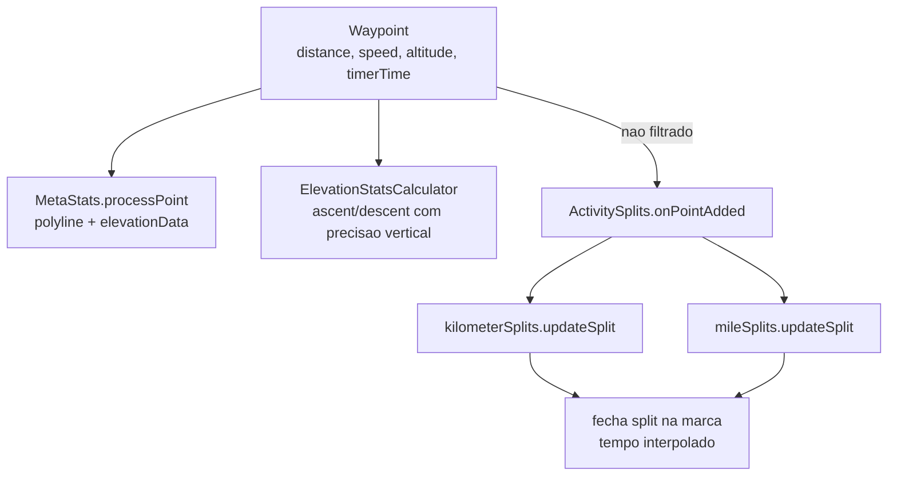

# 04 - Metricas

## Resumo

As metricas da atividade (distancia, velocidade, pace, elevacao e splits por km/milha) sao
derivadas do fluxo de `Waypoint`s descrito na etapa 03. A distancia acumulada ja chega embutida em
cada ponto (`TimedDistancePoint`), calculada a montante; o resto e construido de forma
incremental e imutavel a cada ponto. Dois detalhes se destacam: o Strava mantem splits de
quilometro e de milha ao mesmo tempo, independentemente da unidade do usuario, e fecha cada split na
fronteira exata interpolando linearmente o tempo de cruzamento, em vez de usar o tempo do ponto de
GPS mais proximo. Tempo de movimento (cronometro) e tempo total sao grandezas separadas desde o
modelo do ponto.

## Como o Strava resolve

### Distancia

A distancia nao e recalculada nas camadas de metrica: cada `Waypoint` ja traz a distancia
acumulada em metros e o `timerTimeMs` correspondente, e a entrega as camadas de metrica
empacotada num `TimedDistancePoint` (o ponto nao expoe um getter de distancia solto). O calculo
ponto-a-ponto acontece a montante, na camada que monta o `Waypoint`, usando apenas pontos nao
filtrados. Isso mantem uma unica fonte de verdade de distancia e evita divergencia entre telas.

O ponto exato onde esse incremento e calculado ainda nao foi lido (ver Duvidas em aberto); o que
esta estabelecido e que, da metrica para baixo, a distancia e um dado de entrada, nunca um
recalculo.

### Velocidade e pace

- `Waypoint.speed` e a velocidade instantanea reportada pelo provedor.
- A velocidade media de um trecho sai de `distancia / tempo`. O `ActiveSplit` guarda
  `getAvgSpeedMetersPerSecond` por split.
- O pace (min/km ou min/milha) e o inverso da velocidade. Para o pace "ao vivo", a lista de splits
  expoe versoes "massageadas" (`getMassagedCurrentSplitPace`,
  `getMassagedCurrentSplitAvgSpeedMetersPerSecond`) e uma constante `MIN_SPLIT_PACE_TIME_MS`, que
  evita mostrar pace absurdo quando o split mal comecou (pouco tempo/distancia acumulados).
- Toda contagem de tempo de pace usa o `timerTimeMs` (cronometro, que exclui pausas), nao o tempo
  decorrido total. Por isso pausa automatica e pausa manual nao inflam o pace.

### Splits por quilometro e milha

O gerador de splits (`ActivitySplits`) mantem **duas** listas em paralelo, uma de km e uma de milha,
atualizando ambas a cada ponto:

```
onPointAdded(distancePoint, geoPoint):
    mileSplits.updateSplit(distancePoint, geoPoint)
    kilometerSplits.updateSplit(distancePoint, geoPoint)
```

`getPreferredSplitList` depois devolve a lista na unidade do usuario. A logica de fronteira de cada
lista (em pseudocodigo nosso, a partir do metodo observado):

```
updateSplit(ponto, geo):
    nSplitsEsperados = floor(ponto.distance / tamanhoSplit)      # ex.: tamanhoSplit = 1000 m
    enquanto splitCount <= nSplitsEsperados:
        distFronteira = splitCount * tamanhoSplit
        se existe pontoAnterior:
            # interpola o instante exato em que cruzou a marca
            frac = (distFronteira - pontoAnterior.distance) / (ponto.distance - pontoAnterior.distance)
            tFronteira = pontoAnterior.timerTime + frac * (ponto.timerTime - pontoAnterior.timerTime)
        senao:
            tFronteira = (distFronteira / ponto.distance) * ponto.timerTime
        finishCurrentSplit(distFronteira, tFronteira, geo)        # fecha o split na marca exata
    updateCurrentSplit(ponto.distance, ponto.timerTime, geo)
    pontoAnterior = ponto
```

Pontos a destacar:

1. **Interpolacao na marca.** Como um ponto de GPS raramente cai exatamente no km cheio, o Strava
   calcula o instante de cruzamento por interpolacao linear entre o ponto anterior e o atual. O tempo
   de um split de 1 km reflete o momento real de cruzar os 1000 m, nao o tempo do ponto seguinte.
2. **Multiplos splits de uma vez.** O `enquanto` cobre o caso de um salto grande de distancia (sinal
   recuperado depois de um tunel, por exemplo): varios splits podem ser fechados a partir do mesmo
   par de pontos, cada um na sua marca.
3. **Cronometro, nao relogio.** A interpolacao usa `timerTimeMs`, entao pausas nao entram no tempo do
   split.
4. **Dois sistemas de unidade sempre.** Manter km e milha simultaneos custa pouco e evita recomputar
   se o usuario troca a unidade.

Um `ActiveSplit` guarda `splitNumber`, `startDistanceMeters`/`endDistanceMeters`,
`startTimeMillis`/`endTimeMillis`, `isComplete` e a velocidade media; a lista tambem sabe dar o
split atual (parcial) e o tempo do ultimo split.

### Elevacao (ganho e perda)

A elevacao e tratada a cada ponto que tenha altitude:

```
processElevationIfAvailable(waypoint):
    se waypoint.altitude != null:
        elevationStats = elevationStatsCalculator.processar(
            ElevationPoint(waypoint.altitude, waypoint.verticalAccuracy))
```

Tres coisas ficam claras na leitura do metodo:

1. **Ponto sem altitude nao conta.** O guarda e a unica filtragem feita nesta camada; pontos sem
   altitude simplesmente nao mexem na elevacao.
2. **Acumulacao imutavel.** O calculador devolve um `ElevationStats` novo, que substitui o anterior.
   O `ElevationStats` e um registro de exatamente tres campos (`ascentMeters`, `descentMeters` e o
   ponto de elevacao corrente) e nao guarda buffer nem janela.
3. **Todo o algoritmo vive no calculador.** Como o acumulador nao tem estado de suavizacao, o
   limiar, a janela e qualquer uso da precisao vertical estao dentro da classe calculadora (nome
   ofuscado), que ainda nao foi lida. O que se pode afirmar e que a precisao vertical e *passada*
   a cada ponto, junto com a altitude; usar isso como peso ou como limiar e uma hipotese
   plausivel, nao um fato observado.

Sobre a origem da altitude, isso ja esta resolvido pela etapa 03: o fluxo de localizacao converte a
altitude elipsoidal (WGS84, que o GPS entrega) em altitude acima do nivel medio do mar usando o
`AltitudeConverterDatabase` da AndroidX Core, atras de um feature switch, e cai para a leitura crua
se a conversao falhar. Ou seja, a elevacao das metricas e altitude de GPS corrigida para o geoide,
nao um modelo de terreno (DEM). Nao ha indicio de uso de barometro nesta leitura.

### Meta-estatisticas e polyline

`ActiveActivityMetaStats.processPoint` constroi, de forma imutavel (listas persistentes), duas
colecoes alimentadas so por pontos nao filtrados com geo valido: os `polylinePoints` (a linha do
trajeto desenhada no mapa) e os `elevationData` (altitude + precisao vertical para o perfil de
elevacao). Alem disso guarda `startPoint`, `startSystemTimeMs`, `lastSystemTimeMs` e `pointCount`.
Pontos filtrados nao entram na polyline nem no perfil, mas o `pointCount`/relogio avanca.



## Bibliotecas envolvidas

- Nenhuma biblioteca de terceiros e central aqui: as metricas sao codigo proprio do Strava sobre o
  fluxo de `Waypoint`s. Estruturas de lista imutavel/persistente (`ksv...`) sao usadas para o estado.
- O calculo de distancia de grande circulo e a filtragem possivelmente tocam codigo nativo (etapa 07).

## Decisao para o nosso app

- **Fonte unica de distancia**: acumular a distancia no proprio ponto, a partir de amostras
  aceitas, e nunca recalcular nas telas.
- **Dois relogios**: separar tempo total de tempo de movimento (cronometro) desde o modelo do ponto;
  pace e splits usam o cronometro.
- **Splits**: manter km e milha em paralelo e fechar cada split na marca exata por interpolacao
  linear de tempo, cobrindo saltos com um laco `enquanto`. Guardar velocidade media por split e um
  split parcial corrente, com um piso de tempo/distancia para o pace ao vivo (equivalente ao
  `MIN_SPLIT_PACE_TIME_MS`).
- **Elevacao**: isolar o calculo de ganho/perda numa unica classe com estado proprio, que recebe
  (altitude, precisao vertical) por ponto e devolve o acumulado imutavel. Essa separacao e o que
  permite trocar o algoritmo de suavizacao depois sem tocar no resto. Comecar com um limiar minimo
  de variacao para nao somar ruido do altimetro, e considerar barometro quando disponivel.
- **Polyline e perfil**: construir a linha do trajeto e o perfil de elevacao so com pontos aceitos,
  em estruturas imutaveis para facilitar undo/recuperacao.

## Duvidas em aberto

As tres primeiras dependem de leituras no APK que ainda nao foram feitas; a classe a consultar em
cada caso esta anotada em `analise/04/notas-evidencias.txt`.

- Algoritmo de suavizacao/limiar da elevacao: quanto de variacao de altitude e descartado e como a
  precisao vertical entra na conta. Falta ler a classe calculadora.
- Onde o incremento de distancia e calculado (camada que monta o ponto, ou codigo nativo) e se ha
  correcao por precisao horizontal nesse incremento. Ha um candidato identificado nos usuarios do
  `Waypoint`, ainda nao confirmado.
- Se o pace medio total usa tempo de movimento ou tempo decorrido, e se isso varia por tipo de
  esporte. Falta ler `ActiveActivityStats`.
- Se existe correcao de elevacao por referencia online depois da atividade (seria do lado do
  servidor, portanto fora do alcance da analise estatica do APK).

Resolvido desde a primeira versao deste relatorio: a origem da altitude (GPS corrigido para o
geoide pela AndroidX, ver etapa 03).
