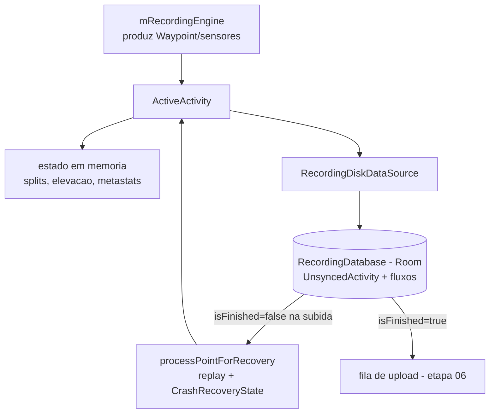

# 05 - Persistencia e recuperacao

## Resumo

A gravacao tem banco proprio: `RecordingDatabase`, um banco Room separado do `StravaDatabase` geral
(etapa 02 mostrou mais de vinte bancos no app, um deles so para gravacao). O cabecalho da atividade
em andamento e a entidade `UnsyncedActivity`, com identificador proprio (`guid`), tipo, tempos,
distancia, calorias, estado de sincronizacao e ate os niveis de bateria no inicio e no fim. Os dados
de alta frequencia (pontos de GPS, sensores, pausas, estado) sao escritos em disco de forma
incremental por um `RecordingDiskDataSource` conforme chegam, nao so no fim. Essa combinacao -- banco
isolado, cabecalho com `syncState`, escrita incremental e um estado de recuperacao de crash --
e o que permite retomar um treino depois de o processo (unico, como visto na etapa 01) ser morto.

## Como o Strava resolve

### Banco dedicado a gravacao

`RecordingDatabase` (Room) existe separado do banco principal. A decisao importa: o banco que recebe
pontos de GPS a cada segundo durante horas nao disputa locks, migracoes nem WAL com escritas de
feed, mapas, analytics ou chat. Falha ou migracao em outro modulo nao arrisca o treino em curso.
O `RecordingDatabase_Impl` gerado pelo Room confirma o uso de migracoes automaticas e invalidation
tracker padrao; o DDL exato das tabelas esta atras da ofuscacao e nao foi fixado nesta leitura.

### O cabecalho: UnsyncedActivity

`UnsyncedActivity` e a linha que representa uma atividade ainda nao sincronizada. Os campos contam o
que e guardado:

| Campo | Para que serve |
| --- | --- |
| `guid` | identificador local da atividade (chave), gerado no aparelho |
| `activityType`, `isIndoor` | esporte e se e indoor |
| `startTimestamp`, `endTimestamp` | inicio e fim |
| `timerTime` | tempo de cronometro (movimento), coerente com etapas 03/04 |
| `distance`, `calories` | resumo acumulado |
| `isFinished` | se a atividade foi encerrada; central para a recuperacao |
| `syncState` | estagio de sincronizacao (fila/upload), base da etapa 06 |
| `sessionId`, `uploadStartTimestamp` | rastreio do upload |
| `liveActivityId` | vinculo com o acompanhamento ao vivo (beacon) |
| `startBatteryLevel`, `endBatteryLevel` | bateria no inicio e no fim, diagnostico de consumo |
| `autoPauseEnabled` | se a pausa automatica estava ligada na gravacao |
| `workout`, `workoutJson`, `athleteWorkoutData` | treino estruturado, quando houver |

Guardar `startBatteryLevel`/`endBatteryLevel` e um detalhe revelador: o Strava mede o proprio consumo
de bateria por atividade, provavelmente para diagnostico e para alertar sobre fabricantes agressivos
com apps em segundo plano.

### Escrita incremental dos fluxos

A `ActiveActivity` (o agregado em memoria da gravacao) tem como dependencias, entre outras:

- `mRecordingDiskDataSource` -- a porta de escrita em disco;
- `mRecordingEngine` -- o motor que processa e produz os pontos;
- `mActivitySplits`, `mElevationStatsCalculator`, `mActiveActivityMetaStats` -- estado derivado;
- `mInProgressRecordingUpdater` -- atualizacao do estado em progresso.

Pela etapa 03 ja se viu que cada ponto e cada evento de pausa sao escritos na hora
(`onAutoPause` grava `PauseType.AUTO_PAUSE` no data source). Os fluxos de alta frequencia tem modelos
proprios -- `Waypoint` (GPS), `HeartRateEvent`, `StepRateEvent`, `SensorData` -- que sao anexados ao
registro da atividade conforme chegam. O resultado e que, a qualquer instante, o disco tem uma visao
quase completa da atividade, nao apenas um resumo em memoria.

### Recuperacao de crash e morte do processo

O modelo de recuperacao combina estado persistido e replay:

- `UnsyncedActivity.isFinished` distingue uma atividade encerrada normalmente de uma interrompida.
  Na subida do servico (etapa 03), o controlador procura a ultima `UnsyncedActivity` nao finalizada e
  a retoma.
- `CrashRecoveryState` e `ActiveActivity.setStateBeforeCrash` guardam o estado necessario para
  reconstruir a sessao; `processPointForRecovery` reprocessa os pontos ja persistidos para
  reconstruir splits, elevacao e polyline sem recalcular do zero de forma divergente.
- `RecoveredActivitySummary` resume o que foi recuperado, provavelmente para informar o usuario.

### Ciclo de vida do registro

1. Inicio: cria `UnsyncedActivity` com `guid`, tipo, `startTimestamp`, `startBatteryLevel`,
   `autoPauseEnabled`, `syncState` inicial, `isFinished=false`.
2. Durante: anexa pontos/sensores/pausas em disco; atualiza `distance`, `timerTime`, `calories`.
3. Fim: grava `endTimestamp`, `endBatteryLevel`, marca `isFinished=true` e avanca o `syncState` para
   a fila de upload.
4. Pos-upload: o registro e consumido pela sincronizacao (etapa 06) e eventualmente vira
   `SavedActivity`.

## Bibliotecas envolvidas

- **Room** (`androidx.room`, Apache-2.0) sobre SQLite: banco `RecordingDatabase` dedicado, com
  migracoes automaticas e invalidation tracker.
- **DataStore** (`androidx.datastore`, Apache-2.0): preferencias (`RecordPreferences`), nao o fluxo de
  pontos.
- Serializacao interna dos modelos (Gson/Moshi/kotlinx conforme o modulo) para campos como
  `workoutJson`.

## Decisao para o nosso app

- **Banco isolado da gravacao**: um banco local separado so para a atividade em curso, para nao
  competir com o resto do app; Room (ou SQLDelight) sobre SQLite.
- **Cabecalho + fluxos**: uma linha de cabecalho (equivalente a `UnsyncedActivity`) com `guid` local,
  tipo, tempos, `timerTime`, distancia, calorias, `isFinished` e `syncState`; tabelas de fluxo para
  pontos de GPS e sensores, com escrita incremental (append) a cada amostra.
- **Bateria**: registrar nivel de bateria no inicio e fim da atividade para diagnostico.
- **Recuperacao**: marcar `isFinished=false` desde o inicio; na subida, detectar atividade
  interrompida e reconstruir o estado por replay dos pontos persistidos (equivalente a
  `processPointForRecovery` + `CrashRecoveryState`), mostrando um resumo do que foi recuperado.
- **GUID local**: identidade gerada no aparelho, independente do servidor, para a atividade existir e
  ser recuperavel antes de qualquer upload.

## Duvidas em aberto

- Layout fisico das tabelas (DDL): os pontos de GPS sao uma linha por amostra ou um blob/stream
  binario anexado? Nao foi fixado por causa da ofuscacao do delegate do Room.
- Politica de retencao: por quanto tempo a `UnsyncedActivity` permanece apos o upload e quando vira
  `SavedActivity`.
- Se ha compactacao/batching das escritas de ponto (por exemplo, gravar a cada N pontos) para poupar
  I/O e bateria, ou escrita ponto a ponto.
- Como os `WorkoutSet`/`WorkoutStep` (treino estruturado) se relacionam com o fluxo de pontos.
