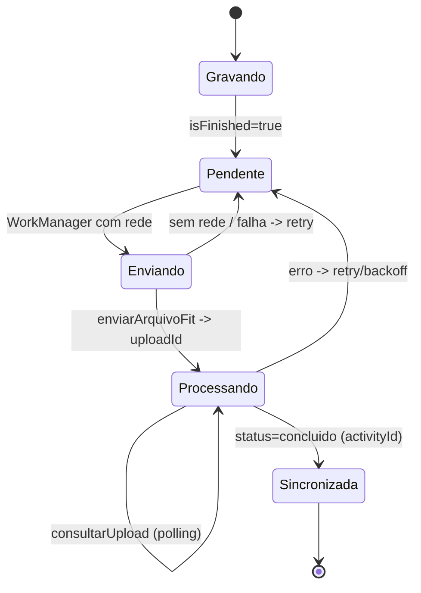

# 06 - Sincronizacao

> Escopo (CLAUDE.md): descricao conceitual e de alto nivel da fila offline e do upload. Este
> relatorio nao mapeia endpoints, caminhos de API nem formatos de requisicao da API privada do
> Strava, e o nosso app nunca conversara com ela. Integracao com o Strava, se existir, sera so pela
> API publica oficial.

## Resumo

A sincronizacao e offline-first e baseada em fila: cada atividade gravada vira uma linha
`UnsyncedActivity` (etapa 05) que permanece no aparelho ate ser enviada com sucesso. O envio e feito
por um worker do WorkManager (`UploadWorker`) que, quando ha rede, percorre as atividades pendentes,
gera um arquivo FIT de cada uma e o envia num fluxo assincrono do tipo "enviar arquivo, receber um
identificador, consultar o processamento ate concluir". O estado de cada atividade e controlado pelo
campo `syncState` e por um resumo de upload (`uploadId`, `status`, `activityId`, `error`).

## Como o Strava resolve

### Fila offline = linhas pendentes no banco

Nao ha uma fila separada: a propria tabela de `UnsyncedActivity` e a fila. Uma atividade encerrada
(`isFinished=true`) com `syncState` de pendente fica no `RecordingDatabase` ate o upload confirmar.
Isso garante que uma atividade gravada sem rede (viagem, montanha, modo aviao) nao se perde e sobe
sozinha depois. O gerenciador de upload le todas as pendentes de uma vez e processa uma a uma.

### Disparo por WorkManager

O envio e um `Worker` do WorkManager (`UploadWorker`). Usar WorkManager da de graca o que uma fila de
upload precisa:

- execucao diferida ate haver conectividade (restricao de rede);
- persistencia do agendamento entre reinicios do app e do aparelho;
- retry automatico com backoff quando o envio falha;
- garantia de nao rodar duas vezes em paralelo para o mesmo trabalho.

Ao iniciar, o worker ainda emite um broadcast de status
(`com.strava.ActivityUploadStatusAction`, com a contagem de pendentes) para a UI refletir "enviando".

### O formato: arquivo FIT

Cada atividade e serializada em um arquivo **FIT** (Flexible and Interoperable Data Transfer, o
formato padrao da industria de esporte/fitness, originado na Garmin/ANT). O fluxo monta o FIT a
partir dos dados persistidos da atividade e o envia. Ha caminhos distintos por tipo: uma atividade
normal (com GPS/sensores) e uma de musculacao seguem construtores diferentes antes do envio. Usar
FIT, e nao um formato proprietario fechado, e uma escolha de interoperabilidade: o mesmo arquivo
serve para exportacao e para outros sistemas.

### Upload assincrono com polling

A interface de upload expoe dois verbos conceituais: enviar o arquivo FIT e consultar o andamento. O
`UploadSummaryDto` descreve a resposta: `uploadId` (identificador do processamento no servidor),
`status` (em processamento / concluido / erro), `activityId` (o id final da atividade quando o
servidor termina de processar) e `error`. O padrao e o classico de upload assincrono:

```
para cada atividade pendente:
    fit = construirArquivoFit(atividade)      # a partir dos fluxos persistidos
    resumo = enviarArquivoFit(fit)            # recebe uploadId, status inicial
    enquanto resumo.status == EM_PROCESSAMENTO:
        resumo = consultarUpload(resumo.uploadId)
    se resumo.status == CONCLUIDO:
        marcar atividade como sincronizada (guarda activityId)
    senao:
        registrar erro e deixar o WorkManager reagendar (retry/backoff)
```

O servidor nao devolve o id definitivo na hora: ele aceita o arquivo, devolve um `uploadId` e
processa em segundo plano; o cliente consulta ate o processamento resolver em um `activityId` ou um
erro. Isso desacopla o envio (rapido) do processamento no servidor (mapas, segmentos, deduplicacao).

### Transicao de estado



### Midia e beacon em paralelo

- As fotos/videos da atividade tem o proprio pipeline de upload
  (`com.strava.mediauploading.worker.*`: `RequestMediaUploadWorker`, `MediaUploadWorker`), tambem em
  WorkManager, separado do upload do FIT.
- O acompanhamento ao vivo (beacon) tem `BeaconUpdateWorker`, que envia posicao durante a atividade;
  e um fluxo de tempo real, nao a sincronizacao pos-atividade.

## Bibliotecas envolvidas

- **WorkManager** (`androidx.work`, Apache-2.0): agendamento, restricoes de rede, retry/backoff,
  persistencia do trabalho.
- **FIT** (formato aberto de dados de atividade): serializacao do treino.
- **OkHttp/Retrofit** (etapa 02): transporte HTTP do envio e da consulta.
- **Room** (etapa 05): a fila e a propria tabela de atividades nao sincronizadas.

## Decisao para o nosso app

- **Offline-first**: a atividade existe e e completa no aparelho antes de qualquer envio; a fila e a
  tabela local de atividades com `syncState` pendente.
- **WorkManager** com restricao de conectividade e backoff para o upload; worker separado para midia.
- **Formato FIT** na exportacao/transporte, por interoperabilidade (e por permitir, no futuro, enviar
  para a API publica oficial do Strava ou de outros, sem acoplar ao nosso backend).
- **Upload assincrono com polling** (ou webhook/callback, se o nosso backend permitir): aceitar o
  arquivo rapido e processar em segundo plano, devolvendo um id final.
- **Nunca** falar com a API privada do Strava. Nosso backend sera proprio (PostgreSQL/PostGIS,
  conforme CLAUDE.md); integracao com Strava, se houver, so via API publica oficial.

## Duvidas em aberto

- Valores e transicoes exatos do enum `syncState` (ofuscado): quantos estagios ha entre pendente e
  sincronizada.
- Politica de retry/backoff concreta (numero de tentativas, limite de tempo, tratamento de erro
  permanente x transitorio).
- Se ha deduplicacao no cliente (evitar subir a mesma atividade duas vezes) alem da do servidor.
- Como a musculacao (sem GPS) e serializada no FIT versus uma atividade com rota.
