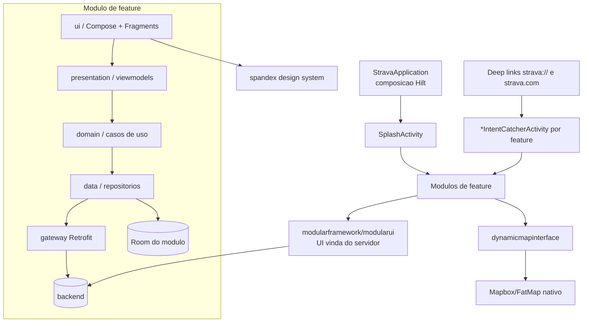

# 08 - Arquitetura geral

## Resumo

O Strava e um app monoproceso (etapa 01) mas fortemente modularizado por feature: cerca de 60
modulos sob `com.strava.*`, cada um com suas proprias camadas de dados, dominio e apresentacao. Tres
pilares sustentam o todo: um sistema de UI vinda do servidor (`modularframework`/`modularui`), que
deixa o backend montar telas como feed e detalhe sem publicar versao nova; um design system proprio
em Compose (`spandex`); e injecao de dependencia com Hilt costurando os modulos. A navegacao e
descentralizada, com uma activity "apanhadora de intent" por feature para os deep links `strava://` e
modelos de destino para a navegacao interna. O nucleo de gravacao estudado nas etapas 03-05 e apenas
um desses modulos (`recording` + `recordingui`), isolado inclusive no banco.

## Como o Strava resolve

### Modularizacao por feature

As ~6.200 classes com nome legivel se distribuem em dezenas de modulos de produto. Os maiores dao o
mapa do app:

| Modulo | Classes aprox. | Area |
| --- | --- | --- |
| `clubs` | 523 | clubes e eventos de grupo |
| `modularui` + `modularframework` + `modularcomponentsconverters` | ~550 | UI vinda do servidor |
| `settings` | 252 | preferencias |
| `recordingui` + `recording` | ~300 | gravacao (etapas 03-05) |
| `strength` + `strengthtraining` | ~290 | musculacao |
| `chats` | 172 | mensageria (sobre Stream Chat) |
| `activitysave` + `activitydetail` | ~320 | salvar e detalhar atividade |
| `gear`, `sharing`, `competitions`, `routing`, `challenges`, `subscriptions`, `fitness`, `photos`, `segments`, `profile`, `feed`, ... | 30-170 cada | demais features |

Cada modulo tende a repetir a mesma estrutura interna de camadas. A contagem de segmentos de pacote
confirma o padrao: `data` (1834 ocorrencias), `domain` (183), `presentation` (162), alem de `ui`,
`model(s)`, `gateway` e `repository`. Ou seja, um Clean Architecture leve e por feature:

```
com.strava.<feature>
  data/         # DTOs, Room, gateways (Retrofit), repositorios concretos
  domain/       # modelos de dominio e casos de uso
  presentation/ # view models, estados, modelos de destino
  ui/           # telas (Compose e/ou Fragments), componentes
  gateway/      # contratos de rede do modulo
```

### UI vinda do servidor (modular framework)

`modularframework`, `modularui` e `modularcomponentsconverters` formam um motor de renderizacao
dirigido por dados: o servidor devolve uma lista de "modulos" (cartoes, linhas, cabecalhos) e o app
os converte em componentes de tela (`GenericModuleList`, `LinkDecorator`, `ModularOverlayManager`).
E isso que permite ao Strava mudar o feed, a tela de detalhe de atividade e paginas de descoberta sem
atualizar o APK. Telas muito dinamicas usam esse caminho; telas de fluxo fixo (gravacao, settings)
sao nativas.

### Design system: Spandex

`com.strava.spandex` e a biblioteca de componentes de interface (ex.: `SpandexButton`,
`SpandexAvatarView`, `SpandexBanner`, upsells), em boa parte ja em Jetpack Compose. Centralizar o
design system num modulo mantem consistencia visual e e reaproveitado tanto pela UI nativa quanto
pela modular.

### Injecao de dependencia e composicao

Hilt (etapa 02) costura tudo: cada modulo expoe seus bindings e entry points
(`Hilt_*`, `HiltWrapper_*EntryPoint`), e a `StravaApplication` e o ponto de composicao. Isso casa com
a modularizacao: um modulo declara o que oferece e o que precisa, sem conhecer a implementacao dos
outros. O motor de mapa, por exemplo, fica atras de uma interface propria
(`dynamicmapinterface`, com implementacoes `dynamicmapmapbox` e `dynamicmapmre`), entao a feature
consome "um mapa" sem depender diretamente do Mapbox.

### Rede e dados

Cada feature fala com o backend por seus proprios `gateway`s (contratos Retrofit) sobre OkHttp, e
persiste no seu proprio banco Room (etapa 02 apontou mais de vinte bancos; etapa 05 detalhou o de
gravacao). Nao ha um "DAO-deus": a fragmentacao de bancos segue a fragmentacao de modulos, reduzindo
contencao e acoplamento. Conversao de dados (DTO <-> dominio) fica nas camadas `data`.

### Navegacao

Nao ha um grafo de navegacao unico. O padrao e:

- Entrada unica pelo `SplashActivity` (launcher), que roteia para o conteudo certo.
- Uma activity "apanhadora de intent" por feature (`ChatIntentCatcherActivity`,
  `ChallengeIntentCatcherActivity`, `OauthIntentCatcherActivity`, `RecordIntentCatcherActivity`,
  etc.) para tratar deep links `strava://...` e links `strava.com`. Isso explica a superficie grande
  de activities exportadas vista na etapa 01.
- Modelos de destino por feature (`...presentation.models.*Destination`) para a navegacao interna,
  padrao de navegacao tipada do Compose.



## Bibliotecas envolvidas

- **Hilt** (DI), **Compose + Fragments/AppCompat** (UI hibrida), **Retrofit/OkHttp** (rede por
  modulo), **Room** (um banco por modulo), **RxJava3 + corrotinas** (concorrencia), **Mapbox/FatMap**
  atras de interface propria. Detalhes e licencas na etapa 02.

## Decisao para o nosso app

- **Modularizar por feature desde o inicio**, com camadas `data/domain/presentation/ui` por modulo e
  um modulo de `core`/design system proprio. Comecar enxuto: `recording`, `activity` (salvar/detalhe),
  `maps`, `profile`, `auth`.
- **Isolar a gravacao** num modulo com banco proprio, como o Strava faz.
- **Interface sobre o mapa** (abstrair o motor), para poder trocar MapLibre por outro sem tocar as
  features.
- **DI com Hilt** (ou Koin) e uma `Application` como ponto de composicao.
- **UI**: Compose + um design system proprio pequeno. Avaliar um mini "modular/server-driven" so se
  precisarmos mudar telas sem publicar; no inicio, telas nativas bastam.
- **Navegacao tipada** (Navigation Compose) com um unico grafo no comeco (somos pequenos), evoluindo
  para apanhadores por feature se a base crescer.
- **Considerar processo separado para a gravacao**: ao contrario do Strava (monoproceso), isolar o
  servico de gravacao em outro processo aumentaria a resiliencia a crash da UI.

## Duvidas em aberto

- Como os modulos sao fisicamente separados no build (Gradle modules vs so pacotes): o APK nao
  distingue, mas a organizacao sugere modulos Gradle.
- Contrato exato do protocolo de UI modular (schema dos modulos vindos do servidor).
- Se ha um modulo de "core/common" central e quao grande e o acoplamento real entre features.
