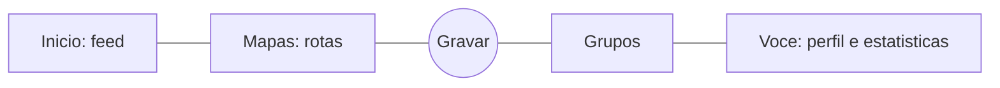

# 10 - Estudo de frontend

## Resumo

O app hoje tem 14 telas funcionais em Material 3 padrao (tema gerado a partir de laranja), sem identidade
visual propria. A meta e uma experiencia no nivel do Strava: navegacao por abas, feed de cartoes de atividade,
tela de gravacao com metricas grandes e detalhe rico (mapa, splits, elevacao). Vamos copiar os padroes de UX,
que sao convencao do genero, e nao a marca: cor, logotipo, icones, fontes, textos e layouts do Strava ficam
de fora (regra do CLAUDE.md e risco de trade dress). Na internet ha criticas de UX e kits genericos de
fitness. Nao ha um "Strava open source" pronto para usar como base.

## Como o Strava resolve (padroes de UX, em palavras nossas)

Fontes publicas: criticas de design (Pratt IxD 2023, 2025 e 2026), artigo de UX no uxdesign.cc e a
reportagem sobre a troca de navegacao de 2021. Nada aqui saiu da decompilacao.

### Navegacao

Em 2021 o Strava passou a usar cinco abas fixas: Inicio, Mapas, Gravar, Grupos e Voce. Gravar fica no
centro, porque e a acao principal.

### Padroes que valem para qualquer app do genero

| Tela | Padrao | Por que funciona |
|---|---|---|
| Feed | Cartao com cabecalho (autor, data, local), titulo, linha de 3 metricas, mapa da rota e acoes sociais | Da para ler o treino em 2 segundos, e o mapa chama a atencao |
| Gravar | Mapa ocupando a tela, seletor de esporte, um botao grande de iniciar | Um toque para comecar |
| Gravando | Metricas grandes (tempo, distancia, pace) legiveis em movimento, sem distracao | O uso real e com o braco balancando ou no guidao |
| Pausa e fim | Pausar e retomar, e na hora de encerrar "Salvar" e "Descartar" bem diferentes | A critica de 2025 aponta que o Strava falha aqui: da para sair sem salvar |
| Salvar | Titulo automatico pelo horario ("Corrida matinal"), descricao e visibilidade | Atrito minimo depois do treino |
| Detalhe | Mapa no topo, grade de metricas, splits por km com barra de pace, grafico de elevacao, voltas | Analise progressiva, do resumo ao detalhe |
| Perfil | Totais da semana, grafico de semanas, recordes | Motiva a repetir |

### Criticas publicas que podemos aproveitar a nosso favor

- O esporte padrao na gravacao deve ser o ultimo usado, e nao um valor fixo.
- Icones sem rotulo (mapa, configuracoes) confundem. Usar sempre icone com texto.
- Salvar e descartar precisam de cor e texto explicitos.

## Bibliotecas envolvidas (no nosso app)

| Lib | Finalidade | Licenca | Situacao |
|---|---|---|---|
| maplibre_gl | Mapa da rota e mapa ao vivo | BSD-2 | Ja em uso |
| go_router | Navegacao com abas (`StatefulShellRoute`) | BSD-3 | No pubspec, sem rotas declaradas ainda |
| fl_chart | Graficos de elevacao, pace e barras semanais | MIT | Proposta (hoje o grafico de elevacao e desenhado a mao) |
| google_fonts ou fonte empacotada (Inter, Barlow) | Tipografia com numeros tabulares para metricas | OFL | Proposta |

Antes de adicionar fl_chart ou fontes, pedir o ok do Gava (regra de dependencias).

## Referencias na internet

- **Criticas e estudos de caso:** Pratt IxD (3 criticas do app de iOS), "A healthy social media: the UX of
  Strava" (uxdesign.cc) e "UX/UI - Strava App" (Medium). Servem para entender o porque, nao para copiar telas.
- **Dribbble e Behance:** a busca por "running app", "run tracker" ou "fitness tracker" traz conceitos com
  linguagens visuais variadas. Bom para escolher a nossa identidade. Tambem existe a conta oficial
  Strava_Design: so para olhar, nunca para copiar.
- **Figma Community:** ha templates gratuitos de fitness e run tracker. Conferir a licenca de cada arquivo
  antes de usar qualquer asset.
- **Codigo aberto em Flutter:** pouca coisa madura. O jogzilla (MIT) e um run tracker simples com Mapbox e
  serve como referencia de estrutura, nao de design. Nosso dominio e nossa gravacao ja estao mais
  completos que os exemplos encontrados.

## Decisao para o nosso app

1. **Identidade propria.** Escolher uma cor primaria diferente do laranja do Strava (hoje usamos
   `Colors.deepOrange`, que e proximo demais). Sugestoes: verde-limao, azul eletrico ou coral. Criar um
   tema unico em `lib/ui/theme/` (cores, tipografia com numeros tabulares, espacamentos, raios) com modo
   claro e escuro.
2. **Shell de abas** com go_router `StatefulShellRoute`: Inicio (feed das nossas atividades), Gravar
   (centro, destacada), Historico/Estatisticas e Voce. Mapas e Grupos ficam para depois, porque dependem
   de backend social.
3. **Componentes reutilizaveis** (`lib/ui/components/`): `ActivityCard`, `MetricTile` (valor grande e
   rotulo pequeno), `MetricRow`, `SplitBar`, `SportChip`, `BigActionButton`, `EmptyState`.
4. **Gravacao:** modo de metricas em tela cheia, que alterna com o mapa ao deslizar. Tela sempre ligada.
   Alvos de toque de pelo menos 64 dp. Segurar para encerrar evita toque acidental.
5. **Ordem de entrega:** tema e componentes, depois shell de abas, feed, gravacao, detalhe e por fim
   perfil com estatisticas semanais. Cada etapa com teste de widget e golden.
6. **Antes do codigo, um mockup:** fazer as 5 telas principais como prototipo em HTML ou Figma para o
   Gava aprovar a identidade.

## Duvidas em aberto

- Qual cor e qual nome/marca o app vai ter?
- O feed tera social (seguir, curtir, comentar)? Isso muda o backend.
- Modo escuro como padrao (comum em apps de treino) ou seguir o sistema?
- Havera tela de mapas e rotas planejadas na primeira versao?

## Fontes

- https://ixd.prattsi.org/2023/01/design-critique-strava-for-iphone/
- https://ixd.prattsi.org/2025/02/design-critique-strava-ios-app/
- https://ixd.prattsi.org/2026/02/design-critique-strava/
- https://uxdesign.cc/a-healthy-social-media-the-ux-of-strava-bb35c0d343f6
- https://medium.com/@yamanmamgain/ux-ui-strava-app-9f65986b9b4e
- https://bikerumor.com/2021/05/05/strava-redesigns-their-app-navigation-to-make-it-easier-to-track-rides-find-friends/
- https://dribbble.com/Strava_Design
- https://github.com/xyzhangg/jogzilla
- https://www.designmonks.co/products/fitness-app-ui-design
